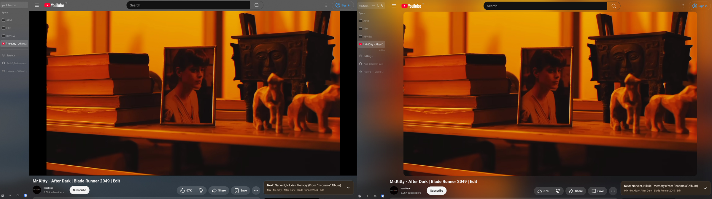
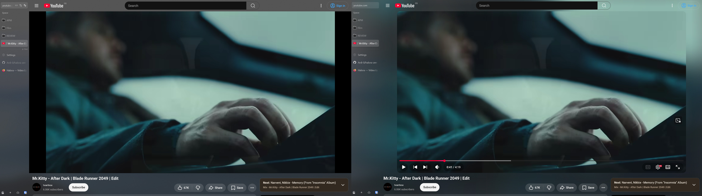
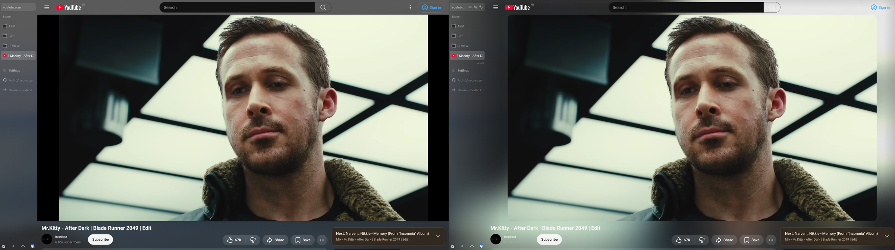

# Halora Tabs for Zen

A [Sine](https://github.com/CosmoCreeper/Sine) mod that carries Halora's live video light from the web page into Zen Browser's tab sidebar. It preserves Zen's theme and transparency, and blends the light across the gap between the sidebar and the page.

This repository contains the **Zen mod only**. The [Halora Firefox extension](https://addons.mozilla.org/firefox/addon/halora/) captures colors from YouTube videos and Twitch streams; the mod receives small color strips from that extension inside the browser. Install both components to extend the page halo into Zen's tabs. The mod does not produce a halo on its own.

## Preview

Halora disabled on the left, enabled on the right. These screenshots show the Firefox extension together with Halora Tabs for Zen.

More color examples

## Install

1. Install the [Halora Firefox extension](https://addons.mozilla.org/firefox/addon/halora/) in Zen.
2. Add [`Ardi-0/halora-zen-tabs`](https://github.com/Ardi-0/halora-zen-tabs) in Sine. Enable scripts from personal repositories if Sine asks, and restart Zen if prompted.
3. Open a YouTube video or Twitch stream. In the extension's **Zen tabs** settings, confirm **Halora Tabs connected**, then enable **Light up tabs**.

If the effect is missing, check that the extension is enabled on the current site, the Sine mod is enabled, and Zen was restarted after installation. Protected video can prevent color sampling. Split views and some compact Zen layouts have not been verified.

## Adjust the effect

Use the extension popup to control **Tab light intensity** and **Fade toward outer edge**. The side nearest the page keeps the page halo's full strength to avoid a visible seam. Only the active tab lights its sidebar. The effect clears when playback ends, you leave the video page, or you enter fullscreen.

With Halora 0.2.54 or newer, **Page background → Automatic** also carries the site's solid background beneath the tab light, so the page and sidebar share the same base color. **Transparent** preserves the existing browser backdrop and the earlier rendering. Window transparency and desktop blur depend on your browser and compositor; this mod does not configure them. The extension's page halo works without this mod or any other transparency mod.

To turn it off, disable **Light up tabs** in Halora or disable this mod in Sine. Removing the mod from Sine and restarting Zen removes its script.

## Privacy and compatibility

The extension processes video pixels locally without storing or transmitting frames, browsing history, or personal information to an external service. Settings stay in local extension storage; export creates a JSON file only when requested. When enabled, the mod receives compact, filtered edge-color strips and a dimming value inside Zen. It never receives full video frames or sends data to a server. Neither component uses an account, analytics, or an advertising network.

The internal Sine ID remains `halo-zen-tabs` to preserve existing installations after the GitHub repository rename. This mod is licensed under [MIT](LICENSE). To report a problem, [open an issue](https://github.com/Ardi-0/halora-zen-tabs/issues) and mention your Zen and Sine versions.
